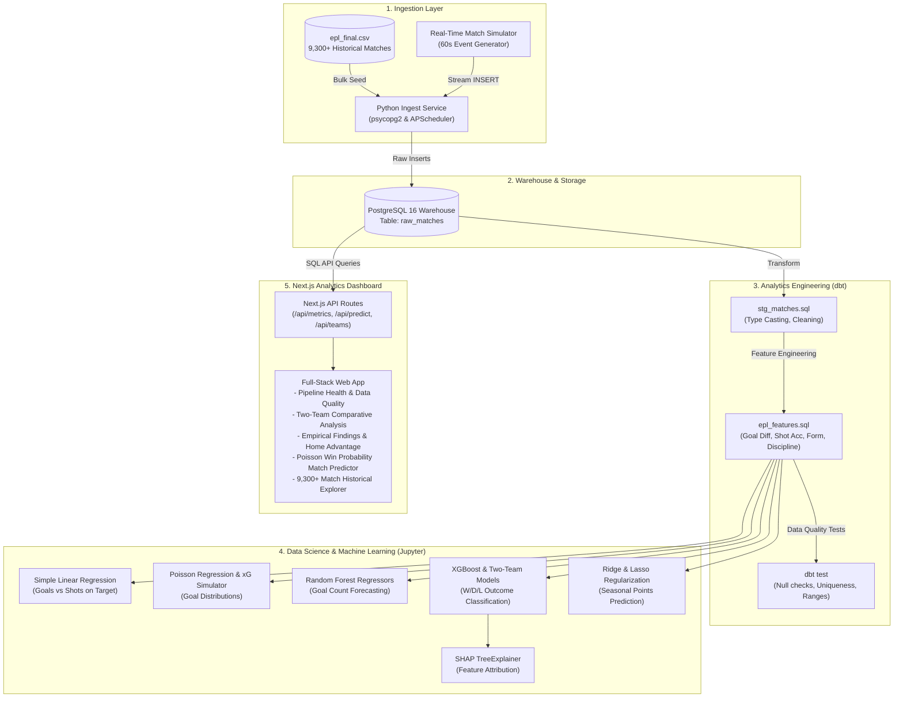
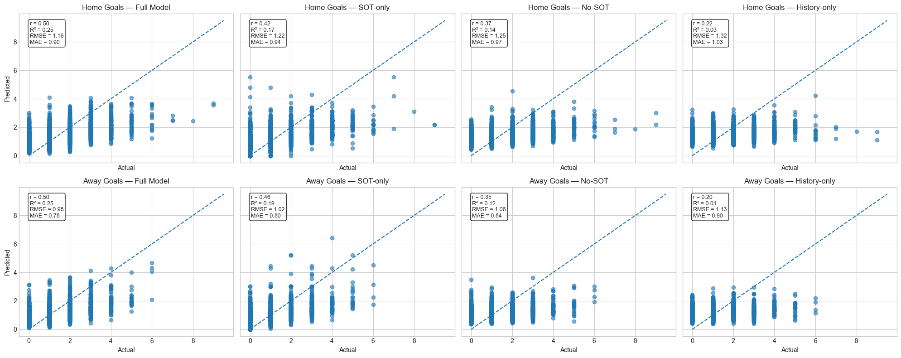
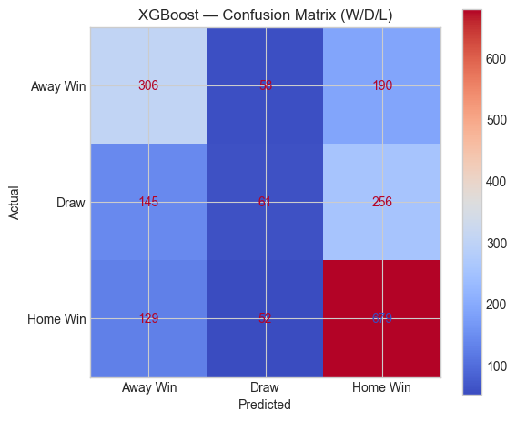
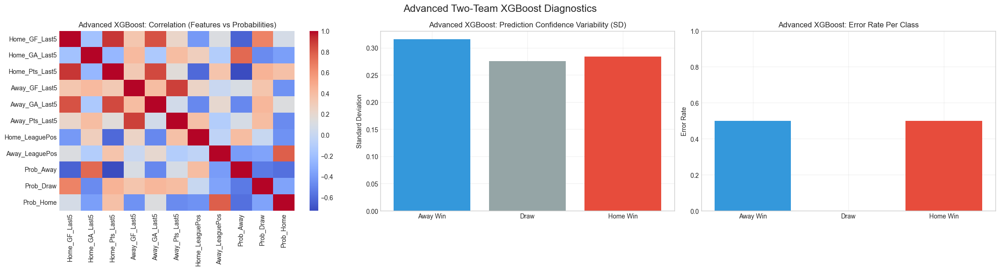
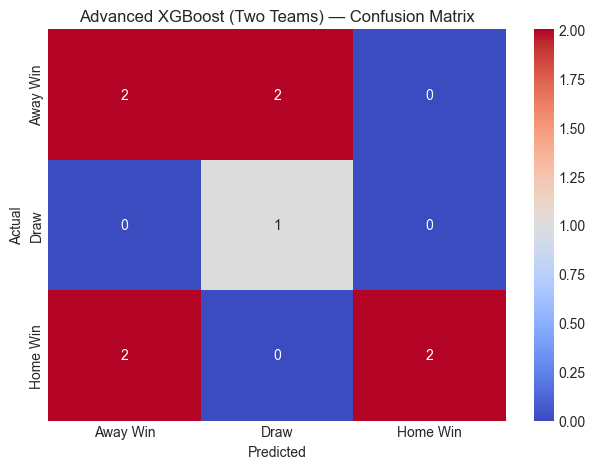
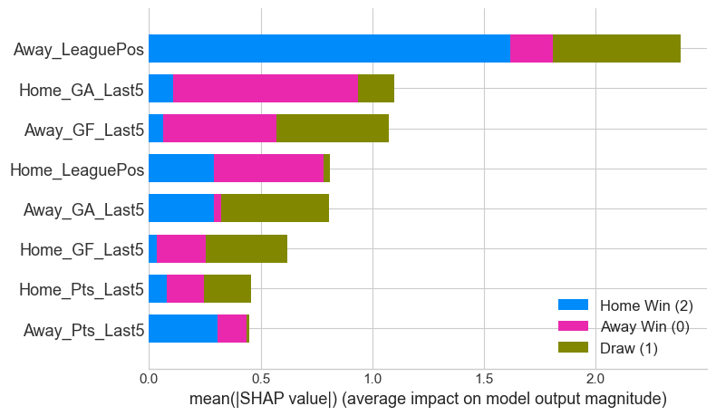
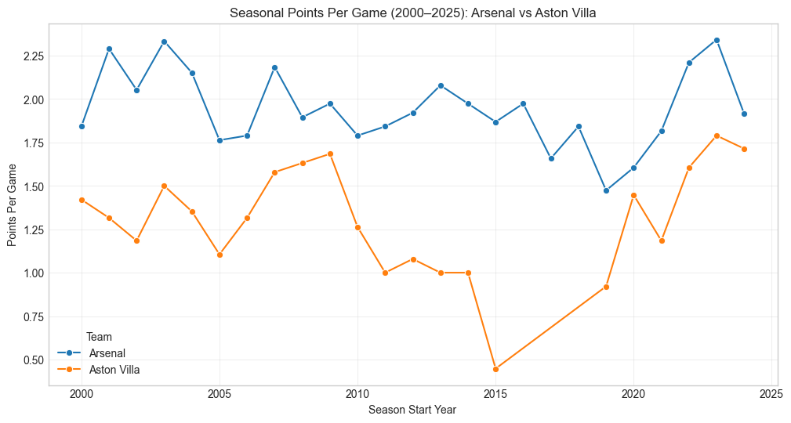
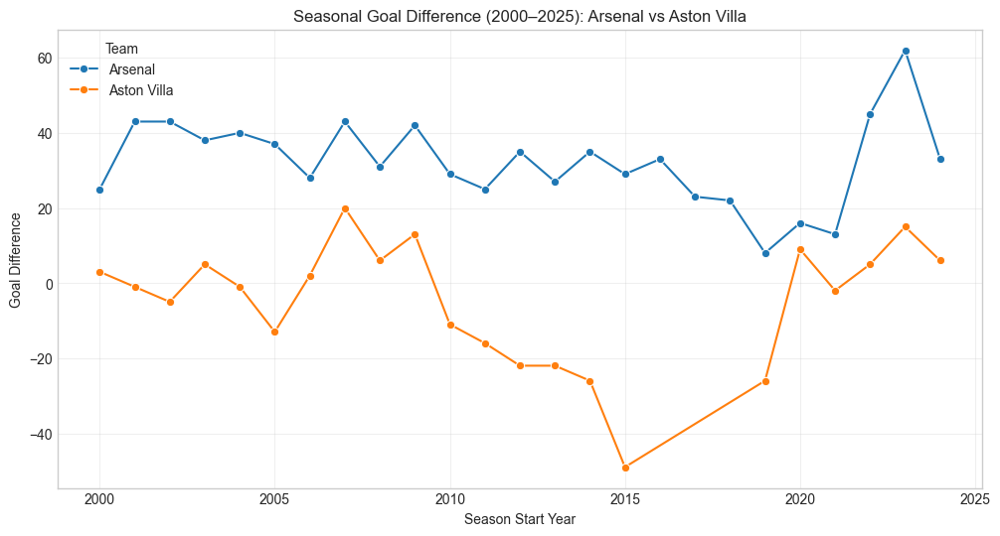

# ⚽ PremPulse: End-to-End Premier League Data Pipeline, Machine Learning Match Prediction & Analytics Platform

[](https://www.python.org/)
[](https://www.getdbt.com/)
[](https://www.postgresql.org/)
[](https://nextjs.org/)
[](https://www.docker.com/)
[](https://xgboost.readthedocs.io/)
[](https://shap.readthedocs.io/)

---

## 📌 Executive Summary

**PremPulse** is an enterprise-grade sports analytics and data engineering platform built for the **English Premier League (EPL)**. Designed as a comprehensive dissertation research project, it bridges the gap between **production data engineering** and **interpretable machine learning**.

The system ingests and standardizes over **9,300+ historical EPL matches** spanning from **1993 to 2025**, supports automated real-time match streaming, builds modular feature engineering marts via **dbt**, evaluates competitive predictive modeling paradigms (Poisson goal simulations, Random Forest, regularized Ridge/Lasso, and XGBoost with SHAP interpretability), and serves insights through a full-stack **Next.js** glassmorphic dashboard with real-time data quality monitoring.

---

## 🏗️ System Architecture



---

## 📊 Experimental Results & Model Outputs

The research investigates multiple machine learning and statistical modeling approaches to evaluate the predictability of association football outcomes.

### 1. Baseline Linear Regression: Goals vs. Shots on Target
A foundational model evaluating whether total goals scored in a match can be linearly approximated purely through shots on target (SOT).

| Metric | Empirical Value |
| :--- | :--- |
| **Target Variable** | Total Goals Scored (`ft_home_goals + ft_away_goals`) |
| **Independent Variable** | Total Shots on Target (`home_shots_on_target + away_shots_on_target`) |
| **Dataset Size** | 7,504 Train / 1,876 Test |
| **Coefficient of Determination ($R^2$)** | **0.0611** (6.11% variance explained) |
| **Mean Absolute Error (MAE)** | **1.2785** |
| **Mean Squared Error (MSE)** | **2.6332** |
| **Root Mean Squared Error (RMSE)** | **1.6227** |
| **Regression Coefficient** | **0.2399** goals per shot on target |

> **Key Takeaway:** While each additional shot on target statistically adds ~0.24 goals ($p < 0.001$), linear regression accounts for only 6.1% of goal variance. This empirical limitation formally justifies non-linear ensemble models and discrete count distributions (Poisson/xG).

---

### 2. Poisson Count Regression & Expected Goals (xG) Simulation
Because goal counts are discrete, non-negative integers, Poisson regression was modeled conditional on attacking metrics:

* **Deviance / Residual Degrees of Freedom:**
  * Model without Intercept: **1.101**
  * Model with Intercept: **1.024** *(close to 1.0, satisfying the Poisson equi-dispersion property $\text{Var}(Y) \approx \mathbb{E}(Y)$)*
* **Exact Goal Match Rate:** **26.33%** (exact score count prediction)
* **Application in Dashboard:** Forms the mathematical core of the **Win Probability Predictor**, taking venue-specific attacking/defending strengths $\lambda_{\text{home}}, \lambda_{\text{away}}$ and generating joint probability grids:
  $$P(X = x, Y = y) = \frac{\lambda_H^x e^{-\lambda_H}}{x!} \times \frac{\lambda_A^y e^{-\lambda_A}}{y!}$$

---

### 3. Random Forest Regressor: Multivariable Goal Forecasting
Four distinct feature ablation configurations were evaluated on the independent test set (1,876 matches) to determine the value of in-game statistics versus pre-match historical records.



#### Detailed Performance Metrics:

| Model Variant | Target | Pearson $r$ | $R^2$ Score | RMSE | MAE |
| :--- | :--- | :---: | :---: | :---: | :---: |
| **Full Model** (All in-game stats + history) | **Home Goals** | **0.50** | **0.25** | **1.16** | **0.90** |
| **SOT-only Model** (Shots on Target only) | **Home Goals** | 0.42 | 0.17 | 1.22 | 0.94 |
| **No-SOT Model** (Corners, Fouls, Cards, History) | **Home Goals** | 0.37 | 0.14 | 1.25 | 0.97 |
| **History-only Model** (Form, Position, Head-to-Head) | **Home Goals** | 0.22 | 0.03 | 1.32 | 1.03 |
| **Full Model** (All in-game stats + history) | **Away Goals** | **0.50** | **0.25** | **0.98** | **0.78** |
| **SOT-only Model** (Shots on Target only) | **Away Goals** | 0.46 | 0.19 | 1.02 | 0.80 |
| **No-SOT Model** (Corners, Fouls, Cards, History) | **Away Goals** | 0.35 | 0.12 | 1.06 | 0.84 |
| **History-only Model** (Form, Position, Head-to-Head) | **Away Goals** | 0.20 | 0.01 | 1.13 | 0.90 |

#### Top 6 Random Forest Feature Importances:
1. `HomeShotsOnTarget`: **14.61%**
2. `AwayShotsOnTarget`: **12.50%**
3. `MatchYear`: **6.66%**
4. `MatchDay`: **5.16%**
5. `HomeCorners`: **4.94%**
6. `AwayFouls`: **4.86%**

---

### 4. Multinomial Logistic Regression: Baseline W/D/L Classification
Trained on 7,504 training matches and evaluated on 1,876 test matches for 3-way match outcome prediction:
* **Overall Accuracy:** **53.14%**
* **Balanced Accuracy:** **50.56%**
* **Macro F1-Score:** **0.501**
* **Pseudo $R^2$:** **0.1305** ($LL = -6935.9$, $p < 0.0001$)

---

### 5. League-Wide XGBoost Classifier
Gradient-boosted decision trees trained across all league fixtures to capture non-linear feature interactions for match result prediction.



#### Classification Report:
| Class | Precision | Recall | F1-Score | Support |
| :--- | :---: | :---: | :---: | :---: |
| **Away Win (0)** | 0.53 | 0.55 | 0.54 | 554 |
| **Draw (1)** | 0.36 | 0.13 | 0.19 | 462 |
| **Home Win (2)** | **0.60** | **0.79** | **0.68** | 860 |
| **Macro Average** | 0.50 | 0.49 | 0.47 | 1,876 |
| **Weighted Average** | 0.52 | 0.56 | 0.52 | 1,876 |
| **Overall Accuracy** | — | — | **55.76%** | 1,876 |

#### Top 10 XGBoost Feature Importances:
```text
 1. num__HomeShotsOnTarget   ████████████████████ 19.90%
 2. num__AwayShotsOnTarget   ██████████████████   18.24%
 3. num__HomeYellowCards     ████████              8.06%
 4. num__MatchYear           ███████               7.50%
 5. num__HomeCorners         ███████               7.12%
 6. num__AwayCorners         ███████               7.01%
 7. num__AwayYellowCards     ██████                6.62%
 8. num__AwayFouls           ██████                6.49%
 9. num__MatchDoW            ██████                6.37%
10. num__HomeFouls           ██████                6.35%
```

---

### 6. Advanced Two-Team Model & SHAP Interpretability
To simulate deep tactical head-to-head modeling, an advanced XGBoost model was trained specifically on rivalries (e.g., **Arsenal vs. Aston Villa**) incorporating rolling 5-match form metrics (`GF_Last5`, `GA_Last5`, `Pts_Last5`, `LeaguePos`).

* **Two-Team Test Accuracy:** **55.56%**
* **Balanced Accuracy:** **66.67%**
* **Macro F1-Score:** **0.556**

#### Visual Model Diagnostics & SHAP Explanations:

| Diagnostic Matrix & Correlation | Confusion Matrix |
| :---: | :---: |
|  |  |

| SHAP Feature Attribution Summary |
| :---: |
|  |

* **SHAP Interpretation:**
  * `Away_LeaguePos` exerted the single largest magnitude impact on model output (>2.3 mean $|\text{SHAP}|$), strongly elevating Home Win probability when the away side holds a lower table standing.
  * `Home_GA_Last5` (defensive fragility in previous 5 fixtures) was the primary driver pushing outcomes toward Away Wins and Draws.
  * `Away_GF_Last5` and `Home_LeaguePos` provided critical balancing vectors for high-scoring draws.

#### Historical Trend Comparisons (2000–2025):
| Seasonal Points Per Game Comparison | Seasonal Goal Difference Comparison |
| :---: | :---: |
|  |  |

---

### 7. Regularized Regression: Seasonal Points Per Game (Ridge vs. Lasso)
Evaluating how aggregated seasonal match dynamics predict final season points per game:

| Metric | Ridge Regression | Lasso Regression |
| :--- | :---: | :---: |
| **Root Mean Squared Error (RMSE)** | **0.1164** | 0.1316 |
| **Mean Absolute Error (MAE)** | **0.0919** | 0.1019 |
| **$R^2$ Score** | **0.9402 (94.02%)** | **0.9235 (92.35%)** |

---

## 💻 Full-Stack Dashboard Modules

The Next.js 14 frontend (`/epl-pipeline/dashboard`) connects directly to PostgreSQL and provides 5 specialized interfaces:

| Tab | Feature | Description |
| :--- | :--- | :--- |
| ⚡ **Pipeline & Data Quality** | Real-time monitoring | Live table counts (`raw_matches`, `stg_matches`, `epl_features`), ingestion latency, completeness rates, and column-level null checks. |
| ⚔️ **Compare Two Teams** | Head-to-Head analytics | Direct clash history between any two Premier League clubs, venue win distributions, goals scored/conceded, and previous match listings. |
| 📊 **Findings & Results** | Empirical league insights | League-wide metrics across 9,300+ matches (home win advantage ~46%, clean sheet rates, comeback wins after HT deficit, discipline). |
| 🔮 **Win Probability Predictor** | Poisson xG simulator | Calculates venue-adjusted attack and defense ratings, home/draw/away win probabilities, and a full 0–5 scoreline probability grid. |
| 📜 **Historical Records** | Match report browser | Instant search and multi-criteria filtering across all seasons, scores, disciplinary events, and teams. |

---

## 📂 Repository Structure

```text
.
├── 2TeamModel.png               # Diagnostic correlation & error plots for Two-Team XGBoost
├── 2team_1.png                  # Longitudinal PPG trend: Arsenal vs Aston Villa (2000-2025)
├── 2team_2.png                  # Longitudinal Goal Difference trend: Arsenal vs Aston Villa
├── advanceXgBoost.png           # Confusion Matrix for Two-Team XGBoost Model
├── advance_2.png                # SHAP Summary Plot for feature importance attribution
├── output.png                   # 4-model Random Forest regression evaluation plot
├── xgboost.png                  # League-wide XGBoost Confusion Matrix
├── main.ipynb                   # Complete Data Science & Machine Learning Research Notebook
├── epl_final.csv                # Curated dataset of 9,300+ Premier League matches
├── football_predictions.csv     # Model-generated match outcome predictions
│
└── epl-pipeline/                # Production Data Engineering & Dashboard Application
    ├── docker-compose.yml       # Orchestrates Postgres, Ingestion, dbt, and Next.js
    ├── db/
    │   └── init.sql             # PostgreSQL schema initialization & indexing
    ├── ingestion/
    │   ├── Dockerfile           # Python 3.11 container definition
    │   ├── ingest.py            # CSV bulk seeder + APScheduler 60s match streamer
    │   └── requirements.txt     # psycopg2-binary, apscheduler
    ├── dbt_epl/
    │   ├── dbt_project.yml      # dbt core configuration
    │   ├── Dockerfile           # dbt runner container
    │   └── models/
    │       ├── staging/
    │       │   ├── sources.yml  # PostgreSQL source declaration
    │       │   ├── schema.yml   # Staging column test assertions
    │       │   └── stg_matches.sql # Type normalization & view definition
    │       └── marts/
    │           ├── schema.yml   # Mart test definitions
    │           └── epl_features.sql # Feature mart (differentials, accuracies, outcomes)
    └── dashboard/
        ├── Dockerfile           # Node.js 20 Next.js container
        ├── package.json         # Dependencies (React, Next.js, pg, Lucide, Tailwind)
        └── src/
            ├── app/
            │   ├── page.tsx     # Main dashboard interface container
            │   ├── layout.tsx   # Root layout and theme definitions
            │   └── api/         # Database REST API endpoints
            │       ├── compare/ # Head-to-head comparison route
            │       ├── findings/# Empirical league findings route
            │       ├── matches/ # Filtered match records route
            │       ├── metrics/ # Data pipeline health & quality route
            │       ├── predict/ # Poisson xG simulation route
            │       └── teams/   # Team names and seasons metadata route
            └── components/      # UI components (Header, Navigation, Tabs, Tables)
```

---

## 🚀 Getting Started

### Prerequisites
* [Docker Desktop](https://www.docker.com/products/docker-desktop/) (v24+) & Docker Compose
* [Python 3.11+](https://www.python.org/) *(optional, for local notebook execution)*
* [Node.js 18+](https://nodejs.org/) *(optional, for local dashboard development)*

### Quickstart with Docker Compose

1. **Clone the repository:**
   ```bash
   git clone https://github.com/your-username/epl-predictive-pipeline.git
   cd epl-predictive-pipeline/epl-pipeline
   ```

2. **Launch all services in detached mode:**
   ```bash
   docker compose up -d --build
   ```

   This orchestrates:
   * **`postgres`** on port `5432` (PostgreSQL 16 with healthchecks)
   * **`ingestion`** (seeds `epl_final.csv` into `raw_matches` and streams live matches every 60s)
   * **`dbt`** (runs `dbt run` and `dbt test` to build `stg_matches` and `epl_features`)
   * **`dashboard`** on port `3000` (Next.js 14 web application)

3. **Access the Application:**
   * **Web Dashboard:** Open [http://localhost:3000](http://localhost:3000)
   * **PostgreSQL Database:** `localhost:5432` (Database: `epl_pipeline`, User: `epl_user`, Password: `epl_pass`)

4. **Verify Pipeline Ingestion:**
   ```bash
   docker compose logs -f ingestion
   ```

---

### Running Machine Learning Experiments (Local Python)

To replicate the machine learning models and visualizations:

1. **Create and activate a virtual environment:**
   ```bash
   python3 -m venv venv
   source venv/bin/activate
   ```

2. **Install scientific libraries:**
   ```bash
   pip install numpy pandas matplotlib seaborn scikit-learn xgboost shap statsmodels jupyter
   ```

3. **Launch Jupyter Lab / Notebook:**
   ```bash
   jupyter notebook main.ipynb
   ```

---

## 🛠️ Data Quality & Transformations (dbt)

Data integrity is enforced continuously through automated dbt testing:

```bash
# Run dbt models inside the pipeline
docker compose run --rm dbt dbt run

# Execute data quality assertions
docker compose run --rm dbt dbt test
```

* **Staging Layer (`stg_matches`):** Cleans raw types, validates date formatting, and establishes zero-null guarantees for team identities.
* **Feature Mart (`epl_features`):** Computes differential goal metrics, shot accuracy percentages, total disciplinary points (yellow/red cards), half-time leads, and one-hot encoded match outcomes (`home_win`, `draw`, `away_win`).

---

## 🎓 Academic Attribution & References

* **Choi, B. S., Foo, L. K., & Chua, S.-L.** (Multimedia University). *Predicting Football Match Outcomes With Machine Learning Approaches*.
* **Dixon, M. J., & Coles, S. G.** (1997). *Modelling Association Football Scores and Inefficiencies in the Football Betting Market*. Applied Statistics, 46(2), 265–280.
* **Lundberg, S. M., & Lee, S.-I.** (2017). *A Unified Approach to Interpreting Model Predictions (SHAP)*. Advances in Neural Information Processing Systems (NeurIPS).

---

## 📄 License
This project is licensed under the MIT License — see the [LICENSE](LICENSE) file for details.
